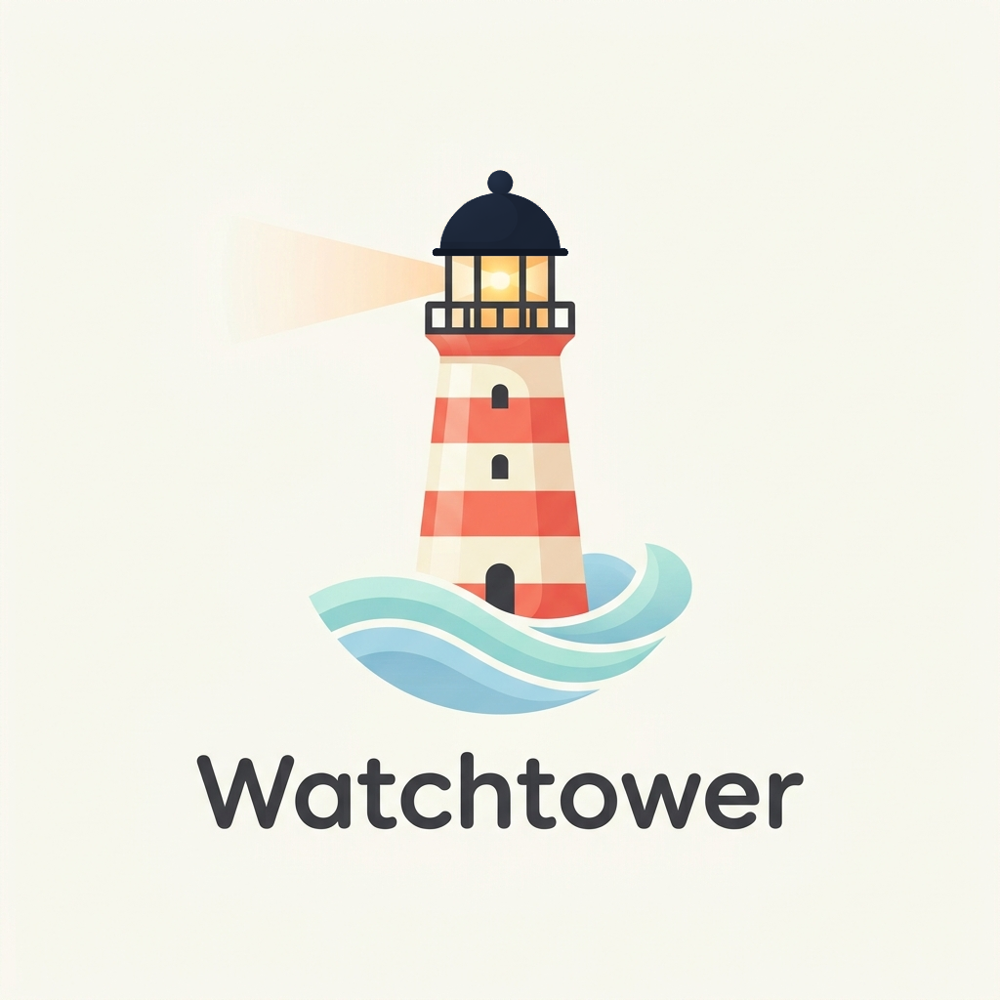
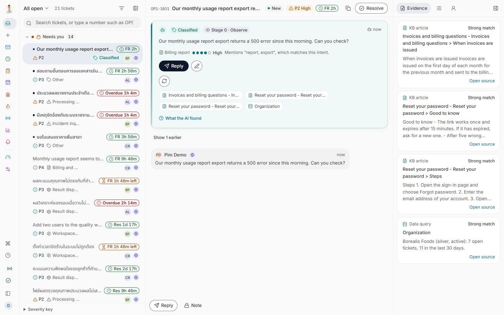
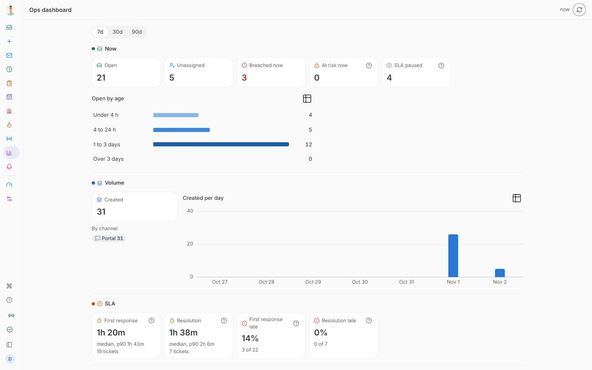
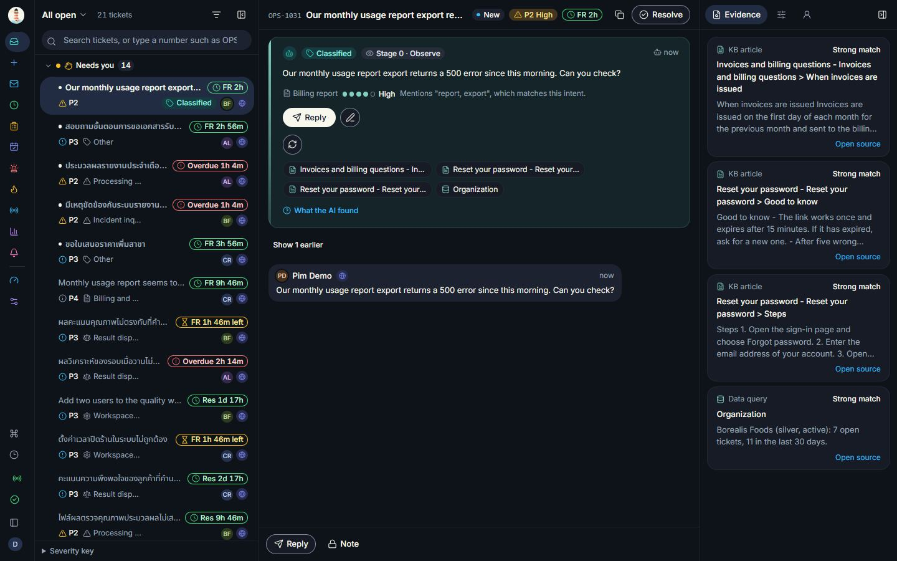
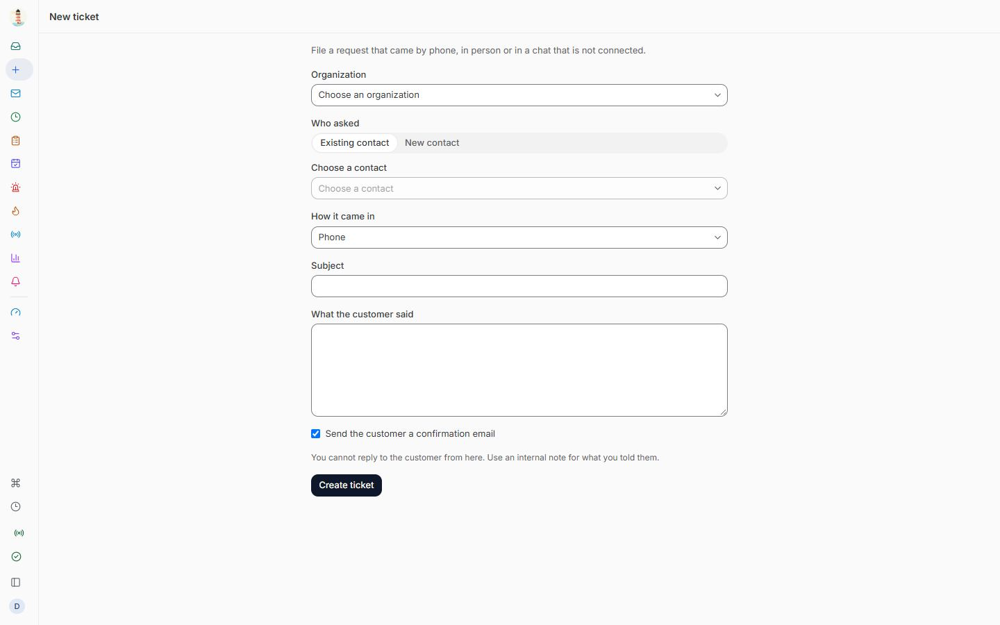
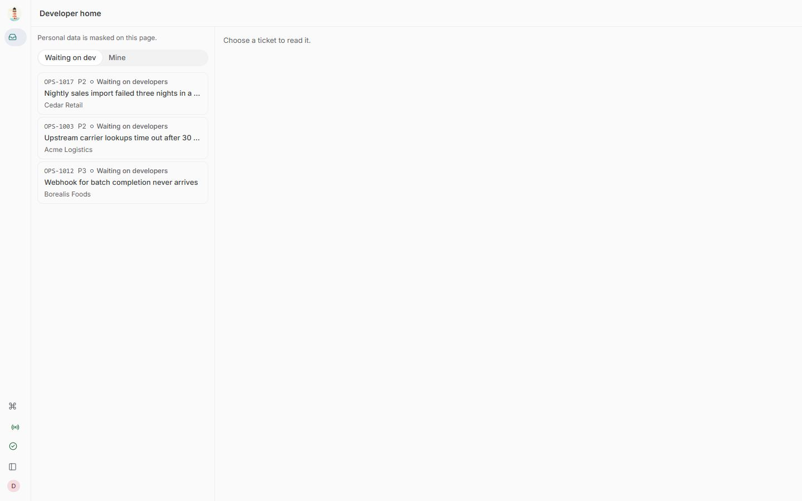
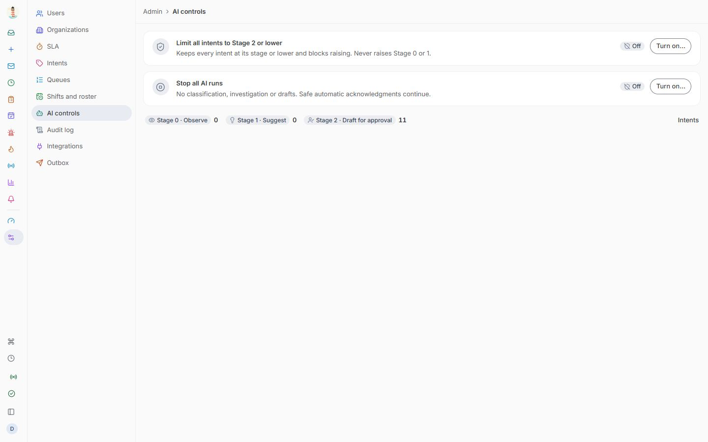
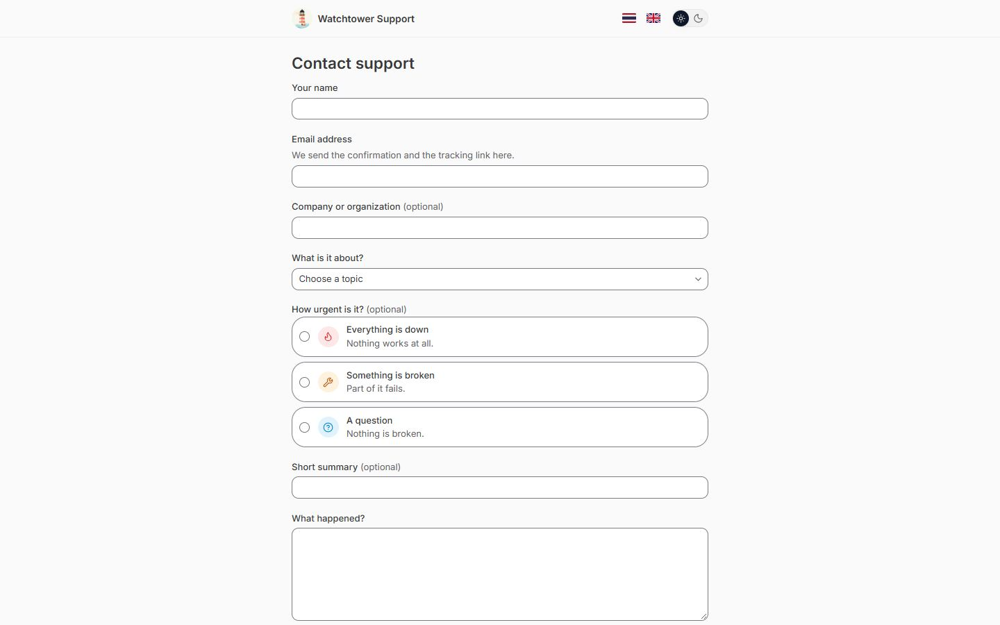
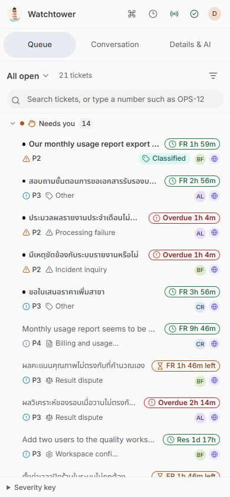

<p align="center"></p>

# Watchtower

Open-source, self-hosted **AI command center for technical support and tech operations teams**: ticketing, an omnichannel inbox (Gmail, LINE, customer portal), alerts and incidents, read-only investigation tools, a knowledge base, shift handoff, and an AI layer that pre-investigates tickets and drafts replies for a person to approve.

> **Status: MVP (`v0.1.0`) plus `main`, not production-proven.** One proof-of-concept instance runs on a single machine against a real Gmail mailbox (push through a tunnel) and real AI through the Claude Code CLI. LINE, Discord, GCP alerts and the Anthropic API path have still only met fakes. See [What is real today](#what-is-real-today).



## Features

**Inbox and tickets**
- One queue for Gmail, LINE, the customer portal and requests a person files by hand (phone, walk-in, chat), sorted into a triage board: needs you, AI working, waiting (most urgent first: SLA state, then priority, then due time).
- Email threads read like Gmail: collapsed history, sender details, trimmed quotes, the original HTML in a sandboxed frame, inline images, remote images blocked until you ask.
- A real email composer for email tickets: To/Cc/Bcc, subject, rich text, signature, quoted history, preview; sent as HTML with a plain-text part, threading headers and attachments.
- Images and files everywhere people write: replies, internal notes, new tickets, shift notes, handoffs, incident notes and the customer portal (paste, drop or pick; metadata stripped from JPEG/PNG).
- SLA per organization tier with business calendars and holidays, first response and resolution clocks, pause while waiting on the customer, at-risk and overdue badges.
- Status workflow, assignment (manual or round robin), merge, duplicate suggestions, tags, internal notes, Thai and English search, realtime updates.
- Customer portal with self-hosted bot protection, tracking links, replies and CSAT surveys.

**AI that prepares, people who decide**
- Every new ticket is classified (intent with a confidence), investigated with read-only tools and given a draft reply grounded on the knowledge base, with sources you can open.
- Autonomy per intent from stage 0 (observe) to stage 2 (draft for approval), enforced in the database. The AI never answers a customer on its own.
- An emergency switch to hold every intent at stage 2 or lower, and a kill switch that stops all AI runs.
- Personal data is redacted before any model call. Every run is audited with model, prompt version, tools and cost, under daily caps.
- `mock`, `anthropic` or `claude-cli` provider (a bridge to the Claude Code CLI for a self-hosted instance on one machine), model tiers set in configuration and no model names in the code. With `claude-cli` the AI works while the host is online and waits and retries when it is not.
- A knowledge base you can also keep as Markdown files in a folder and sync with `pnpm kb:sync`.

**Operations**
- Alerts from GCP Monitoring (Pub/Sub push) and signed webhooks: dedup, correlation, a service catalog, escalation, snooze and heartbeats.
- Incidents with severity, a timeline, linked tickets, mass communication and "what changed".
- A public status page with email subscriptions, off until you turn it on.
- Investigation tools for logs, metrics, repositories and data, all read-only, with a shared rate budget and guarded SQL.
- Usage metrics with anomaly detection that opens proactive tickets, and a Client Health Score.
- An Ops dashboard: queue now, volume, SLA, quality, reliability, AI, team, product usage, service status. A missing figure says why instead of showing zero.

**Team**
- Shifts, roster, clock-in, handoff with acknowledgement, a daily brief and shift notes.
- Roles: client, agent, lead, head, and a `dev` role that reads tickets with personal data masked.
- A head console for users, organizations, SLA, intents, queues, the audit log, AI controls, integrations and the outbox.
- Discord webhook and in-app notifications. Keyboard-first, TH/EN, light and dark, works on a phone (PWA).

## Screenshots

| | |
|---|---|
|  |  |
| Ops dashboard | Dark mode |
|  |  |
| A ticket that came by phone | Developer view, personal data masked |
|  |  |
| AI controls | Customer portal |

<p align="center"></p>

Screenshots come from the demo stack: fictional data, mock AI, and mock embeddings, which is why the evidence above includes a password article. They predate the current look (every page is now the floating sheet of the Overview page) and the Gmail-style email view.

## Try it in five minutes (no accounts needed)

You need Docker with Compose, plus Node and pnpm for the demo data. Nothing leaves your machine: mail goes to Mailpit and the AI is a deterministic mock.

```bash
cp .env.example .env
docker compose up -d --wait --build
pnpm install
pnpm db:seed
```

| Open | For |
|---|---|
| http://localhost:3000 | The app. Choose a role on the login page (dev login) |
| http://localhost:3000/portal | The customer portal |
| http://localhost:8025 | Mailpit: mail the system "sent" |
| http://localhost:4000/docs | OpenAPI |

Stop with `docker compose down`, and add `-v` to delete the data too.

**A year of demo data.** After `pnpm db:seed`, `pnpm db:seed:year` adds one fictional year: about 3,800 tickets with Gmail-style HTML mail, 95 knowledge base articles, incidents, alerts, a year of shifts and handoffs, AI runs and CSAT, plus screenshots in MinIO when the `S3_*` settings are present. It is deterministic, runs once (a second run does nothing) and refuses production and any database that already holds more than 100 tickets. Inside Docker, without copying passwords: `docker compose -f docker-compose.yml -f docker-compose.seed.yml --profile seed run --rm --no-deps seed`.

## Running with real accounts

Follow [`docs/runbooks/credentials.md`](docs/runbooks/credentials.md), which lists each credential, who can create it and how. Keep your env file outside the repo and start with `docker compose --env-file <path> up -d --wait --build`. To deploy on GCP: [`docs/runbooks/staging-gcp.md`](docs/runbooks/staging-gcp.md) and [ADR-014](docs/decisions/ADR-014-gcp-deployment.md).

Before you connect anything real:

- **Use a test mailbox and a test LINE Official Account first.** A connected LINE account acknowledges each new conversation automatically, with a safe template and no person involved. Replies a person approves go to whoever wrote in.
- **Connecting Gmail imports the last 7 days**, up to 500 messages (`GMAIL_FULL_SYNC_DAYS`, `GMAIL_FULL_SYNC_MAX_MESSAGES`). With a real AI provider, each one costs money until the daily cap stops it.
- **Gmail push and LINE webhooks need a public HTTPS address.** On `localhost`, sign-in, the Gmail connection, AI, Discord and SMTP can work, but new mail and LINE messages won't arrive by themselves. For Gmail on one machine, the `gmail-tunnel` container does it for you (below).
- **The AI never answers customers on its own.** Every intent stays at autonomy stage 2 or lower (draft for approval), enforced in the database.
- **Personal data is redacted before it reaches a model, as far as patterns and known names allow.** A name typed into free text that the system doesn't know can get through. Decide whether you accept that before turning on a real provider.

## AI bridge: Codex or Claude CLI (one machine)

A self-hosted instance can use a subscription CLI login through the [AI bridge](docs/decisions/ADR-031-ai-cli-bridge.md). Select `AI_BRIDGE_MODE=codex` (default) or `claude`; switching requires restarting the bridge and updating model settings. It never switches vendors automatically. Redaction, audit, budgets and approval gates remain in the application.

```bash
# First log in separately on the machine that will run the bridge:
codex login
# In your external env file: AI_PROVIDER=ai-cli, AI_BRIDGE_MODE=codex,
# AI_BRIDGE_TOKEN=<16+ random characters>, AI_MODEL_DEEP/STANDARD/LIGHT=<available model IDs>,
# AI_MODEL_PRICES=<price entry for every selected model; subscription entries may be zero>.
# Keep any agent-specific model overrides compatible with the selected backend.
node --env-file=<external-env-path> tools/ai-bridge/server.mjs
```

`pnpm ai-bridge` loads a local `.env` if present. The host listener defaults to `127.0.0.1:4317`; Docker Desktop callers use `AI_BRIDGE_URL=http://host.docker.internal:4317` and may require an explicit bind address. The container service is `ai-bridge` (`--profile ai`), reachable at `http://ai-bridge:4317` with no published port. Its dedicated `codexstate` volume needs its own login; do not mount your entire Codex home. Every generation request requires the bridge token. Production or non-loopback application URLs require explicit `AI_BRIDGE_ALLOW_REMOTE=true`.

The bridge runs Codex without user config, project instructions or tools, in an empty temporary directory. Unsupported CLI isolation settings fail closed. It never logs prompts, responses or CLI stderr. Offline calls wait and retry without mock fallback. `AI_PROVIDER=claude-cli`, `CLAUDE_CLI_*` settings and `pnpm claude-bridge` remain supported for existing Claude setups; the legacy provider refuses a Codex backend. See [the runbook](docs/runbooks/ai-bridge.md) for switching and rollback.

## Gmail push on one machine (`gmail-tunnel`)

The `gmail-tunnel` container ([ADR-020](docs/decisions/ADR-020-gmail-tunnel-container.md)) opens a Cloudflare quick tunnel to a filter that lets through only signed `POST /v1/inbound/gmail/push`, then points your Pub/Sub push subscription at the new random URL with a service account that may update only that subscription. The OIDC audience stays a fixed `GMAIL_PUSH_AUDIENCE`, so the api needs no restart when the URL changes. Setup and IAM: [`docs/runbooks/local-poc.md`](docs/runbooks/local-poc.md) section 4.

```bash
docker compose --env-file <path> --profile gmail-tunnel up -d --build --no-deps gmail-tunnel
```

## What is real today

| Area | State |
|---|---|
| Tickets, queues, SLA and business calendars, RBAC, audit log, realtime workspace, TH/EN, light/dark, PWA | Built, tested with real Postgres and Redis |
| Customer portal, tracking links, CSAT, manual tickets, masked `dev` role | Built, tested |
| Gmail (OAuth), push through `gmail-tunnel`, Gmail-style view and email composer | **Run against a real mailbox** on one POC instance: push, ingest, inline images. Sending HTML with Cc/Bcc from the new composer is tested against fakes; whether Gmail strips `Bcc` from what it delivers is not yet confirmed |
| LINE Messaging API, Discord webhook, SMTP relay | Code complete, tested against fakes, **never run against the real service** |
| AI: triage, investigation, drafts, grounded on the knowledge base | **Real calls through `ai-cli` (Codex)** on the POC; Claude mode remains supported. All three configured tiers and the audited API path passed a synthetic live smoke test. **The `anthropic` API path has never made a real call** |
| Knowledge base, Markdown folder sync | Works, but search uses mock embeddings, so it isn't semantic search yet |
| Image and file uploads | Built, tested with real Postgres and MinIO; EXIF/GPS stripped for JPEG and PNG only |
| Alerts, incidents, status page (off by default), usage metrics, Client Health Score | Built, tested with simulated input |
| Investigation tools (logs, metrics, repo, data) | Read-only. Logs, metrics and repo read fixtures; data can read a database you point it at |
| Ops dashboard, head console, shifts and handoff | Built, tested |

**Not yet built:** the AI assistant bubble and AI-written briefs with evidence links (backend only, on branch `wip/t-134`, with its last security fixes not yet re-reviewed), real embeddings, Vertex AI, LINE Login, Web Push, autonomy stage 3 and everything else in Phase 3.

## Develop

```bash
pnpm install
docker compose up -d --wait postgres redis minio minio-init mailpit
pnpm db:migrate && pnpm db:seed
pnpm dev
pnpm lint && pnpm typecheck && pnpm test
pnpm test:e2e              # browser, mocked api
pnpm test:e2e:fullstack    # browser, web, api, worker, Postgres, Redis, Mailpit
```

Integration and end-to-end tests write to the database: point them at throwaway containers, never at a stack you use ([`docs/07-TESTING.md`](docs/07-TESTING.md)). On Windows, run build, typecheck and browser tests one at a time.

TypeScript monorepo (pnpm + Turborepo): `apps/web` (Next.js), `apps/api` (NestJS), `apps/worker` (BullMQ), `packages/db` (Drizzle, Postgres 16 + pgvector), `packages/ai`, `packages/channels`, `packages/connectors`, `packages/domain`, `packages/shared`, `packages/ui`.

## Documentation

- [`docs/01-PRD.md`](docs/01-PRD.md): the product spec
- [`docs/decisions/`](docs/decisions/README.md): architecture decisions
- [`docs/09-SECURITY.md`](docs/09-SECURITY.md): security checklist
- [`docs/07-TESTING.md`](docs/07-TESTING.md): how to test, and against what
- [`docs/runbooks/local-poc.md`](docs/runbooks/local-poc.md): one instance on your own machine with real Gmail and AI
- [`docs/runbooks/credentials.md`](docs/runbooks/credentials.md), [`docs/runbooks/staging-gcp.md`](docs/runbooks/staging-gcp.md): credentials and deployment
- [`CHANGELOG.md`](CHANGELOG.md): what changed

## Working on this repo with an AI agent

Start with [`AGENTS.md`](AGENTS.md) (rules and a map of the documents), then [`HANDOFF.md`](HANDOFF.md) (current state). Claude Code users: `CLAUDE.md` and `/status`.

## License

Apache-2.0.
